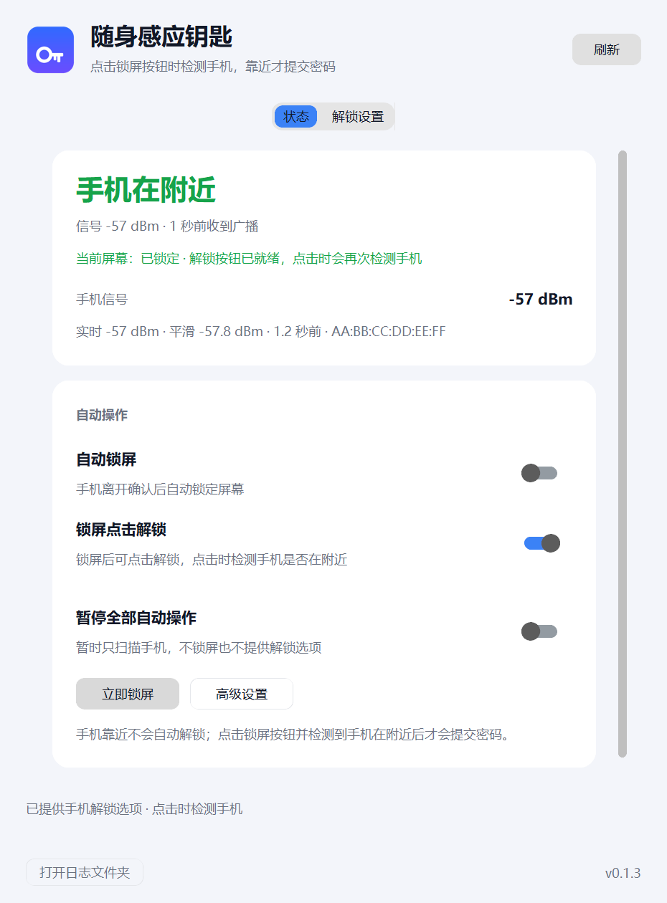
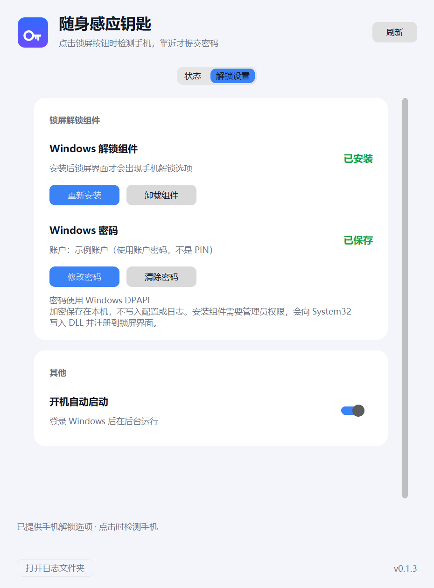
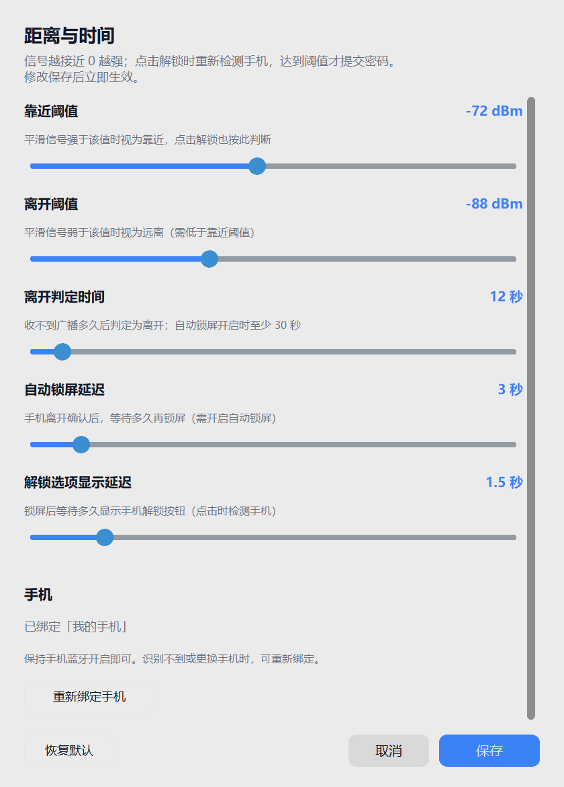

# PhoneKey · 随身感应钥匙

用手机当作 Windows 电脑的感应钥匙。锁屏后点击「手机感应解锁」时，应用会检测手机
是否在附近；确认在附近才会提交已保存的密码并解锁。手机端不需要安装 App。

## 界面预览

<p align="center">
  
  
</p>
<p align="center">
  
</p>

## 功能

- **手机作为钥匙**：扫描手机系统的 BLE 广播，手机无需安装应用。
- **点击时检测手机**：锁屏后可点击手机解锁；点击时实时检测手机是否在附近，靠近才提交密码。
- **启动防误触**：锁屏刚出现时，即使磁贴被 Windows 自动选中也不会解锁。
- **离开自动锁屏**（可选开关）：手机离开确认后锁定电脑。
- **本机加密保存密码**：使用 Windows DPAPI，按当前用户加密，不写入配置或日志。
- **托盘常驻**：支持开机自启；暂停后只扫描、不执行任何自动操作。

## 工作原理

```
手机 BLE 系统广播
        │
        ▼
PhoneKey.exe ── 扫描 RSSI / 锁屏时单次检测
        │
        │  STATUS + UNLOCK（锁屏后，携带 DPAPI 解密的密码）
        ▼
\\.\pipe\CredentialProviderPipe
        │
        ▼
UnlockProvider.dll（运行在 LogonUI.exe）
        │
        │  用户点击「手机感应解锁」
        │  VERIFY ──► \\.\pipe\PhoneKeyVerify ──► PhoneKey.exe
        │  ◄── OK / DENY（实时 BLE 检测）
        ▼
仅当手机在附近时，Windows 验证密码并解锁
```

- 靠近判定使用平滑 RSSI；点击解锁只接受最近一次广播，手机系统广播约 15 秒一轮，过期数据不会放行。
- 锁屏出现时应用检查一次手机并同步给组件；点击时组件会再次实时检测，失败则保留按钮供重试。
- 手机离开不会撤销按钮；只有暂停、关闭点击解锁、解锁成功或应用退出时才发送 `CLEAR`。

## 系统要求

- Windows 11 x64（Windows 10 未验证）
- 蓝牙 4.0 及以上适配器
- 保持蓝牙开启、持续发送系统 BLE 广播的 Android 手机
  （已在小米 14 Pro 上验证；其他机型可在「高级设置」中重新绑定后尝试）
- 当前 Windows 账户的**密码**（不是 PIN，也不是 Windows Hello）

## 安装使用

1. 从 [Releases](../../releases) 下载 `PhoneKey.exe`。
2. 运行 `PhoneKey.exe`，打开「解锁设置」。
3. 点击「设置密码」，输入当前 Windows 账户密码；应用会用 `LogonUser` 验证后以
   DPAPI 加密保存到 `%LOCALAPPDATA%\PhoneKey\secret.bin`。
4. 点击「安装组件」，在 UAC 提示中允许管理员权限。组件会安装到
   `C:\Windows\System32` 并注册到 Windows 锁屏界面。
5. 保持手机蓝牙开启。锁屏后点击「手机感应解锁」；应用检测到手机在附近后才会提交
   密码。检测通常瞬间完成，信号不稳定时最多等待约 3 秒。

卸载组件可在应用内点击「卸载组件」，或使用管理员 PowerShell 执行
`installer\uninstall_cp.ps1`。从旧版 `MiPresenceKey` 升级时，应用会自动迁移
`settings.json`、`secret.bin` 和开机启动项。

## 安全模型

- **解锁必须由人点击且手机在附近**：锁屏按钮不会自动提交；`SetSelected` 仅在应用
  已授权且超过 1.5 秒启动保护期后返回 `TRUE`。点击后组件还会通过本机管道要求应用
  做一次实时 BLE 检测，未通过则不提交密码，按钮保留供重试。
- **密码不落明文**：只保存在 DPAPI 加密的 `secret.bin`，仅在锁屏时通过本机命名
  管道交给 LogonUI；日志和配置中不包含密码。
- **组件是系统级修改**：安装需要管理员权限，会写入 System32 和 HKLM 注册表。
  发布包中的 DLL 未做代码签名，Windows 可能提示未知发布者；请从本仓库 Releases
  下载并核对 `SHA256SUMS.txt`。
- **威胁边界**：DPAPI 只能阻止其他用户或其他电脑解密。以当前用户身份运行的恶意
  程序仍可读取该密码；如果这是你的威胁模型，请使用独立的 Windows 账户或不要启用
  密码保存。
- 应用不联网、不上传数据、无遥测。

## 从源码构建

需要 Windows 11、Python 3.12、Visual Studio 2022（C++ 桌面开发工作负载）。

```bat
py -3.12 -m venv .venv
.venv\Scripts\python -m pip install -r requirements.txt

credential_provider\build_msvc.bat
credential_provider\test_msvc.bat
copy /y credential_provider\build\UnlockProvider.dll installer\

.venv\Scripts\python tools\test_control_logic.py
.venv\Scripts\python -m PyInstaller --noconfirm PhoneKey.spec
```

产物为 `dist\PhoneKey.exe`，已内置 `UnlockProvider.dll` 和安装脚本。

只使用 MinGW / TDM-GCC 时：

```bash
credential_provider/build_mingw.sh
```

脚本会下载构建所需的 Windows SDK 头文件，编译并运行凭证提供程序测试。

## 项目结构

```
app/                  托盘应用、BLE 扫描、状态机、DPAPI 存储
credential_provider/  Windows 凭证提供程序（C++）及测试
installer/            凭证提供程序的安装 / 卸载 PowerShell 脚本
tools/                离线状态机测试与界面截图脚本
PhoneKey.spec         PyInstaller 打包配置
.github/workflows/    GitHub Actions 发行版工作流
```

## 已知限制

- 需要账户密码；仅使用 PIN / Windows Hello 的账户无法使用。
- 部分手机系统会降低蓝牙广播频率或休眠后停止广播，此时无法稳定判断距离。
- 锁屏界面上的组件 UI 由 Windows 控制，样式会随系统版本变化。
- 点击解锁时会实时等待一次手机广播；信号不稳定时最多约 3 秒，超时按“不在附近”处理。
- 安装或更新 DLL 后需要重新锁屏（或重启）才会由 LogonUI 加载新版本。

## 许可

本项目使用 MIT 许可证，见 [LICENSE](LICENSE)。
`credential_provider/` 派生自 PsyChip 的 MIT 项目，原始许可证见
[credential_provider/LICENSE](credential_provider/LICENSE)。
