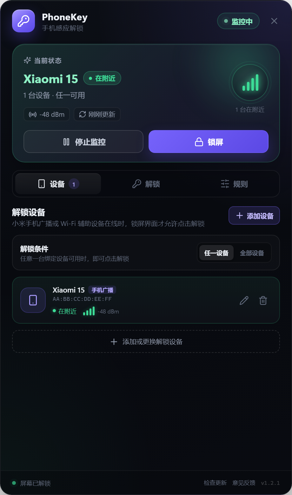
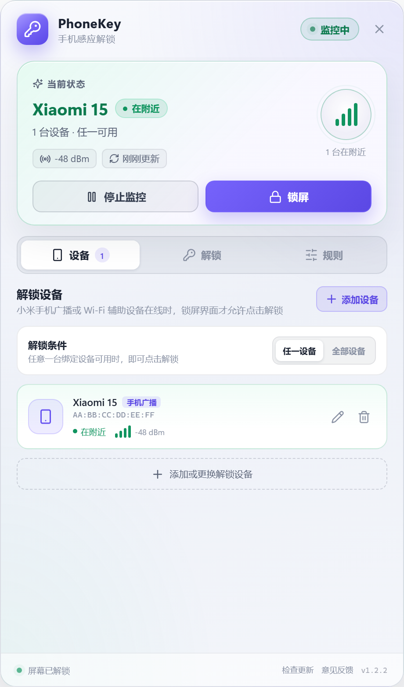
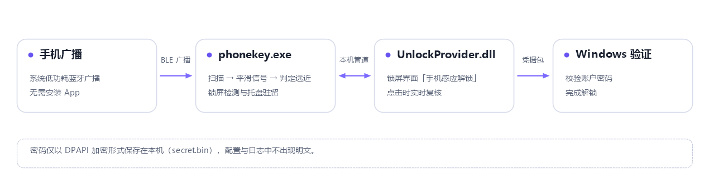
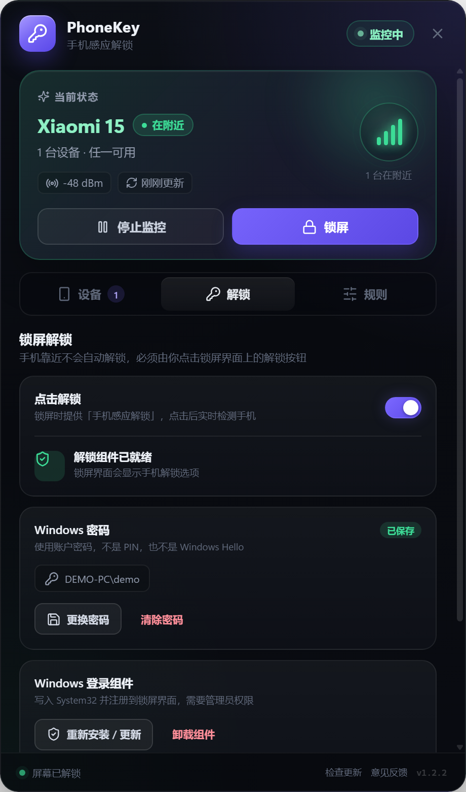
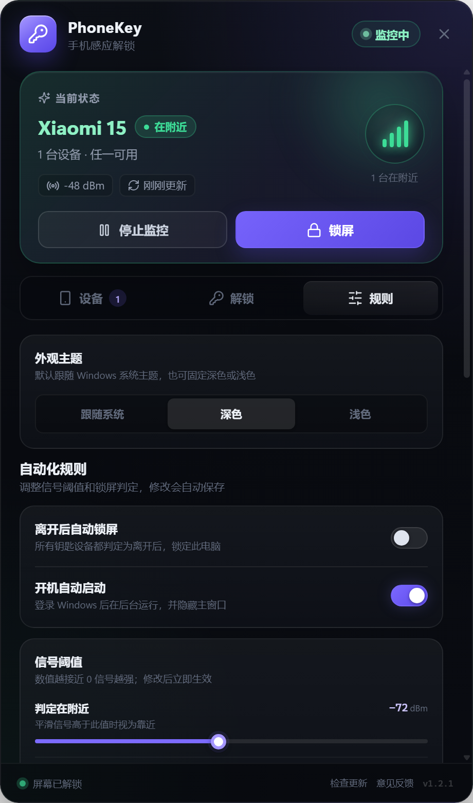
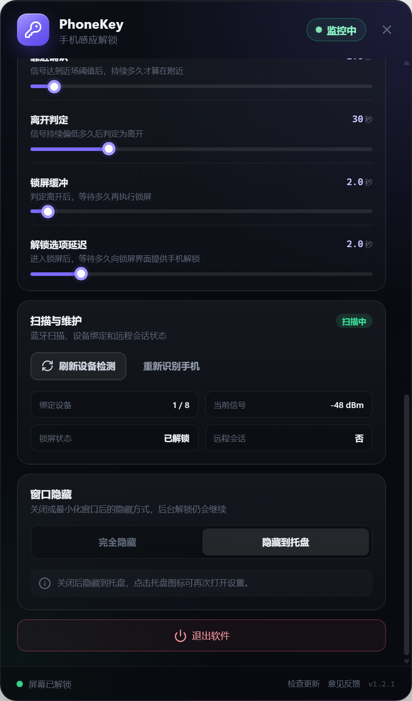

# PhoneKey · 手机感应解锁

<p align="center">
  
  
</p>

<p align="center">
  <sub>Windows 11 x64 · Tauri 2（Rust + React）· 手机端无需安装 App · MIT</sub>
</p>

用手机当作 Windows 电脑的感应钥匙：手机在附近时，锁屏界面会出现「手机感应解锁」
磁贴；**只有点击磁贴才会提交密码并解锁**，单纯靠近不会触发任何登录动作。

> **手机蓝牙广播目前只支持小米。** 其他品牌手机和 iPhone 不会出现在「小米手机」
> 列表，也不能通过蓝牙绑定。可改用 Wi-Fi 辅助（弱检测），或按固定 MAC 地址绑定
> 普通 BLE 设备；Wi-Fi 辅助只能判断是否在同一局域网，不能判断距离。

## 功能特性

- **手机即钥匙，无需装 App**：持续扫描小米手机系统的低功耗蓝牙（BLE）广播，
  手机不需要配对，也不需要安装任何客户端。当前手机蓝牙广播仅支持小米。
- **点击确认才解锁**：靠近只会让锁屏界面出现解锁磁贴；点击磁贴时，应用会
  立即重新确认手机仍在附近，确认通过后才向 Windows 提交密码。
- **防误触保护**：进入锁屏后默认延迟约 1.5 秒才提供手机解锁选项；Windows
  自动选中磁贴时，也需经过 1.5 秒保护期才会被视为有效选择。
- **多设备与策略**：最多绑定 8 台钥匙设备，可给每台设备重命名并随时恢复
  设备原名；解锁策略可选「任一设备可用」或「全部设备可用」。
- **Wi-Fi 辅助（可选，弱检测）**：可添加手机 IP 或主机名，定时探测是否仍在
  同一局域网。它只认填写的 IP / 主机名，不校验 MAC，没有 RSSI、不能判断距离；
  手机休眠或禁止 ping、路由器 AP 隔离、IP 变化、访客设备都可能误判。
  它只作辅助，仍必须点击锁屏磁贴才会解锁。
- **离开自动锁屏（可选）**：钥匙设备从附近变为离开后，自动锁定电脑；
  只在状态变化时触发一次，启动时就未检测到手机或一直不在附近不会触发。
  离开判定带超时窗口和缓冲时间，避免广播间隔造成误锁。Wi-Fi 辅助同样没有
  距离信息，离开判定不能证明手机不在隔壁房间。
- **密码加密保存**：账户密码经 `LogonUser` 验证后，用 Windows DPAPI 按当前
  用户加密保存，配置文件和日志中不出现明文。
- **远程会话暂停**：检测到远程桌面会话时，自动暂停锁屏与解锁等自动操作。
- **安静的驻留**：支持开机自启并后台运行；关闭主窗口会销毁界面并释放
  WebView2 内存。窗口关闭且屏幕未锁定时会暂停 BLE 扫描和 Wi-Fi ping，
  锁屏或重新打开窗口后自动恢复（开启「离开自动锁屏」时需持续探测，不会暂停）；
  从托盘图标或再次运行快捷方式即可重新打开。应用不访问互联网、无遥测；
  Wi-Fi 辅助只在本机局域网内探测指定地址。
- **更新与反馈**：底部的「检查更新」「意见反馈」分别打开 GitHub Releases
  与 Issues，不需要在应用内另做更新服务。
- **深浅色主题**：跟随系统 / 深色 / 浅色三种模式，设置、确认弹窗均为应用内
  自绘样式，不再弹出系统网页框。

## 工作原理

<p align="center">
  
</p>

- `phonekey.exe`（Rust 桌面端）通过系统蓝牙持续扫描小米手机的系统 BLE
  广播（服务 UUID `0xFCC0`），对 RSSI 做指数平滑，再用「靠近确认时间 /
  离开判定时间」两个时间窗判断手机与电脑的远近。
- 可选 Wi-Fi 辅助：后台每 2 秒 `ping` 一次手机 IP / 主机名，只把「刚刚
  探测成功」视为弱在线信号；只认填写的地址，不校验 MAC，没有 RSSI，
  不能测距，也不会提供密码。
- 屏幕锁定且手机在附近或 Wi-Fi 辅助在线时，应用通过本机命名管道通知登录
  组件，让锁屏界面提供「手机感应解锁」磁贴。
- 用户点击磁贴后，组件会向应用发起实时校验：应用要求最近几秒内收到
  手机广播，或 Wi-Fi 辅助刚刚探测成功；超时就返回拒绝，并提示改用 PIN。
  校验通过才通过命名管道取回 DPAPI 解密的密码，交给 Windows 完成登录。
- 手机离开、暂停监控、进入远程会话或应用退出时，解锁能力随之失效，
  无需额外操作。

## 界面导读

### 设备页

<p align="center">
  
</p>

- 顶部卡片展示当前状态：信号强度、是否在附近、监听中的设备数量，
  并提供「停止监控 / 开始监控」和「锁屏」快捷按钮。只用 Wi-Fi 辅助时，
  信号位置会显示同网在线状态。
- 设备列表中每台钥匙标注来源（「手机广播」「BLE」「Wi-Fi 辅助」）和状态；
  Wi-Fi 辅助显示同一局域网在线/未响应。点击铅笔图标可以重命名，重命名
  弹窗里的「重置为原名」会恢复设备自身上报的名称；删除设备或更换绑定
  也在设备卡片右侧完成。
- 「解锁条件」可选择任一设备可用即可解锁，或要求全部设备都可用。

### 解锁页

<p align="center">
  
</p>

- 「点击解锁」开关控制是否在锁屏界面提供手机解锁磁贴。
- 「Windows 密码」用于保存、更换或清除账户密码；密码只用于本机登录，
  不会被写入配置或日志。
- 「Windows 登录组件」负责安装 / 更新 / 卸载锁屏组件；安装与卸载都会
  请求管理员权限。
- 手机没电、蓝牙关闭或组件停止运行时，仍可使用 PIN 或密码照常登录。

### 规则页

<p align="center">
  
</p>

- **外观主题**：默认跟随 Windows 系统主题，也可固定深色或浅色。
- **自动化规则**：离开后自动锁屏、开机自动启动（登录后后台隐藏运行）。
- **信号阈值**：判定在附近 / 判定已远离的 dBm 值，数值越接近 0 信号越强，
  修改后立即生效。
- **判定时间**：靠近确认、离开判定、锁屏缓冲、解锁选项延迟；手机广播模式下，
  离开判定不会低于 30 秒，避免锁定过早。

<p align="center">
  
</p>

- **扫描与维护**：刷新设备检测、重新识别手机（保留已添加的 Wi-Fi 辅助），
  并显示绑定数量、当前信号、锁屏状态和远程会话状态。
- **窗口隐藏**：点右上角 × 会销毁界面窗口并释放 WebView2 内存；从托盘图标或
  再次运行快捷方式即可重新打开。窗口关闭且未锁屏时会暂停 BLE 与 Wi-Fi 探测；
  锁屏后自动恢复，磁贴与点击校验不受影响。若开启「离开自动锁屏」，后台探测
  会保持运行，以便判断离开。
- **退出软件**：退出后手机解锁即不可用，锁屏时仍需使用 PIN 或密码。

## 安装使用

1. 从 [Releases](../../releases) 下载安装包 `PhoneKey-*-setup.exe`（按当前用户安装），
   或便携版 `PhoneKey-*-portable.zip`（解压后运行，`installer/` 目录需与
   `phonekey.exe` 保持同级）。
2. 启动 PhoneKey，在「设备」页点击「添加设备」。手机蓝牙广播目前仅支持小米，
   其他品牌手机不会出现在「小米手机」列表；可点「Wi-Fi 辅助」填写手机 IP /
   主机名，或手动填写 MAC 地址绑定普通 BLE 设备。
   Wi-Fi 辅助只认填写的 IP / 主机名，不校验 MAC，只能判断同一局域网，
   不能判断距离；手机需允许被 ping，路由器不能开启 AP 隔离。它不是安全边界，
   添加后仍必须点击锁屏磁贴才会解锁。
3. 打开「解锁」页，点击「保存密码」，输入**当前 Windows 账户的密码**
   （不是 PIN，也不是 Windows Hello 凭据）。
4. 点击「安装解锁组件」，在 UAC 提示中允许管理员权限。组件会安装到
   `System32` 并注册到锁屏界面；安装或更新后需重新锁屏（或重启）才会加载新版本。
5. 锁屏后，手机在附近时磁贴会显示为手机解锁状态，点击即可解锁；
   如果提示未检测到手机，请稍等片刻再试，或改用 PIN。

卸载组件：应用内「卸载组件」，或使用管理员 PowerShell 执行
`installer\uninstall_cp.ps1`。删除应用时，设置保存在 `%LOCALAPPDATA%\PhoneKey`，
可一并删除。

## 安全模型

- **解锁必须由人点击**：靠近只提供磁贴，不会自动提交密码；磁贴被 Windows
  自动选中时，也要经过 1.5 秒保护期。
- **点击时实时复核**：组件在点击后向应用请求凭据，应用要求最近几秒内收到
  手机广播，或 Wi-Fi 辅助刚刚探测成功才放行；手机不在附近、Wi-Fi 未响应、
  监控暂停或处于远程会话时直接拒绝。
- **密码不落明文**：密码仅以 DPAPI 加密形式保存在 `secret.bin`，只在本机
  通过命名管道交给登录组件；日志与配置中不包含密码。
- **组件是系统级修改**：安装需要管理员权限，会写入 `System32` 和注册表
  `HKLM`；发行包中的 DLL 未做代码签名，Windows 可能提示未知发布者，
  请从本仓库 Releases 下载使用。
- **Wi-Fi 辅助不是安全边界**：它只证明某个 IP / 主机名在局域网内响应 ping，
  不校验 MAC，不能证明手机在电脑旁边，也不能证明设备身份；同一网络中的其他
  设备或伪造地址可能造成误判。它只作辅助，仍需点击磁贴，且点击时同样会实时复核。
- **威胁边界**：DPAPI 只能阻止其他用户或其他电脑解密。以当前用户身份运行的
  恶意程序仍可读取该密码；如果这属于你的威胁模型，请使用独立账户或不要启用
  密码保存。
- **可恢复**：随时可卸载组件恢复系统原始登录界面，不影响 PIN / 密码登录。

## 系统要求

- Windows 11 x64（Windows 10 未验证）
- 蓝牙 4.0 及以上适配器，蓝牙保持开启（仅使用 Wi-Fi 辅助时可不要求蓝牙）
- 小米手机的系统 BLE 广播（**当前唯一支持的手机蓝牙广播来源**，
  已在小米 14 Pro 上验证）。其他品牌手机和 iPhone 不会出现在设备列表，
  也不能通过蓝牙绑定；可尝试 Wi-Fi 辅助，但只能判断同网，不能判断距离。
- Wi-Fi 辅助（可选）：只按 IP / 主机名判断，不校验 MAC；电脑和手机需在
  同一局域网，手机允许 ICMP ping，路由器未开启 AP 隔离；IP 变化或手机休眠
  会显示未响应
- 当前 Windows 账户的**密码**（仅使用 PIN / Windows Hello 的账户无法使用）
- 安装解锁组件需要管理员权限
- 锁屏组件依赖 Microsoft Visual C++ 2015–2022 x64 运行库；缺失时安装包会提示，
  安装组件前请先补装，否则锁屏界面不会出现手机解锁选项

## 常见问题

**为什么必须用账户密码，不能用 PIN？**
Windows 锁屏的密码凭据只能携带账户密码去校验；PIN 由 Windows Hello /
TPM 容器托管，凭证提供程序无法代为提交。

**手机没电、蓝牙关闭或应用退出后还能解锁吗？**
可以。手机解锁只是附加方式，PIN 或密码始终有效；应用退出后手机解锁磁贴
不会再出现。

**支持哪些手机？**
手机蓝牙钥匙目前只支持小米手机的系统广播（服务 UUID `0xFCC0`，已在小米 14 Pro
上验证）。其他品牌手机和 iPhone 没有相同广播，不会出现在「小米手机」列表，
也不能通过蓝牙绑定。可以改用两条路径：普通 BLE 设备按固定 MAC 地址手动绑定；
或添加 Wi-Fi 辅助，但它只认 IP / 主机名，不校验 MAC，只能判断同一局域网，
不能判断距离，手机休眠、禁止 ping、路由器 AP 隔离或 IP 变化都会造成误判。

**为什么不能适配全部手机？**
这不是再增加几个品牌名称就能解决的问题，而是各手机系统对外提供的蓝牙能力
不同：

- **没有统一的被动身份广播。** PhoneKey 依赖小米系统广播中的厂商数据
  （服务 UUID `0xFCC0`）识别手机，这套格式由厂商私有定义。其他 Android
  厂商通常没有等价的公开广播，字段也不公开；不同小米型号或系统版本也可能
  不广播或字段不同，因此目前只在小米 14 Pro 上验证。iPhone 在 App 进入后台
  或被关闭后，也不允许持续广播自定义数据。
- **蓝牙地址不等于身份。** 大量 Android 手机使用随机 MAC 地址并定期轮换，
  未配对时电脑无法解析；按 MAC 绑定会在地址变化后失效。
- **后台广播和扫描受系统限制。** Android 的 Doze、后台扫描节流会降低广播或
  扫描频率，系统也可能随时回收后台进程。手机端不装常驻 App，就无法保证
  “手机一直可被发现”。
- **只凭名称和信号强度不能安全认证。** 附近任何设备都可以使用相同名称或
  伪造广播；如果跨品牌方案只是“看到某个蓝牙地址就解锁”，会绕过点击确认
  和身份校验。
- **主动连接也无法通用。** 电脑只能连接正在广播可连接服务、且暴露约定
  GATT 服务的手机；普通手机在锁屏或后台不会开放这种服务，持续连接也更耗电。

要在其他品牌上做到可靠又安全，需要给手机安装配套 App：首次扫码或配对时写入
一把密钥，电脑只保存公钥；点击锁屏磁贴后由手机对随机挑战签名，电脑验签成功
才提交密码。这样能确认设备身份并防伪造，但不再是“手机端无需安装 App”，
还要分别开发 Android 和 iOS 客户端，目前尚未实现。

现有版本中，其他品牌手机可以改用：

- 地址稳定的普通 BLE 设备，按固定 MAC 地址绑定；这只能证明该地址在附近，
  不能证明是手机，仍可能被伪造；
- Wi-Fi 辅助，只判断是否在同一局域网，不校验 MAC，也不能判断距离；
- PIN 或密码登录。iPhone 若只需要“离开后自动锁屏”，可使用 Windows
  动态锁（Dynamic Lock）；它不提供手机靠近后的点击解锁。

**Wi-Fi 辅助能当近距离钥匙吗？**
不能。它只判断指定 IP / 主机名是否在局域网内响应 ping，不读取也不校验 MAC，
无法证明手机在电脑旁边；同一网络中的其他设备也可能占用同一地址或冒充。
它适合辅助确认手机是否还留在家或办公室，仍然必须点击锁屏磁贴才会解锁。
不要把 Wi-Fi 辅助当成唯一的身份或距离凭据。

**距离判断忽远忽近怎么办？**
蓝牙 RSSI 受环境影响较大，可在「规则」页调整判定阈值与确认时间；
手机处于深度省电时可能降低广播频率，建议将 PhoneKey 与手机放在同一房间使用。
Wi-Fi 辅助没有信号强度，只有在线/未响应，无法用来判断远近。

**自动锁屏会在什么时候触发？**
只在钥匙设备「在附近 → 离开」时触发一次，等待锁屏缓冲后锁定。启动时就
没有检测到手机、手机一直不在附近，或你手动输入密码重新登录后仍不在附近，
都不会再次自动锁屏；需要等手机重新靠近再离开，才会再次触发。

**窗口关闭后还会扫描手机或 ping 吗？**
窗口关闭且屏幕未锁定时不会；锁屏、重新打开窗口或开启「离开自动锁屏」时会恢复。
开启「离开自动锁屏」后需要未锁屏时持续探测，否则无法判断是否离开。

**为什么远程桌面时不能手机解锁？**
检测到远程会话时，应用会暂停自动锁屏并拒绝解锁请求，防止远程操作期间
误锁本机或产生不可预期的登录。

**更新组件后锁屏界面没变化？**
组件由登录界面进程加载，安装或更新后需要重新锁屏或重启，新版本才会生效。

**安装组件时提示缺少 VC++ 运行库？**
锁屏组件由 Windows 登录界面加载，依赖 `VCRUNTIME140.dll`。请先安装
Microsoft Visual C++ 2015–2022 x64 运行库，再回到应用重新安装组件；
安装完成后重新锁屏或重启。

**会收集或上传数据吗？**
不会。应用不访问互联网、无遥测，所有设置保存在本机；Wi-Fi 辅助只在本机
局域网内探测你填写的 IP / 主机名。

## 从源码构建

需要 Windows 11、Node.js 22、Rust stable（MSVC 工具链）以及 Visual Studio 2022
的「使用 C++ 的桌面开发」工作负载（含 Windows SDK）；WebView2 运行时由系统提供。

```bat
npm ci
npm run tauri dev
npm run tauri build
```

- `npm run build:provider` 会用 Cargo 编译 `provider/`（Rust 实现的凭证提供程序），
  并复制产物到 `installer/UnlockProvider.dll`；`dev` 与 `build` 都会自动调用它。
- 可执行文件输出在 `target/release/phonekey.exe`，NSIS 安装包输出在
  `target/release/bundle/nsis/`。
- 仓库自带 GitHub Actions 发行工作流：推送 `v*` 标签即构建安装包与便携版，
  标签名需与 `src-tauri/tauri.conf.json` 中的版本号一致（如 `v1.2.2`）。

## 项目结构

```
src/                React + TypeScript 界面（设备 / 解锁 / 规则）
src-tauri/          Rust 桌面端：BLE 扫描、Wi-Fi 同网探测、判定状态机、DPAPI、组件安装、托盘与自启
provider/           Rust 实现的 Windows 凭证提供程序（UnlockProvider.dll）
installer/          组件的安装 / 卸载 PowerShell 脚本与构建产物
scripts/            构建辅助脚本
.github/workflows/  GitHub Actions 发行构建
docs/images/        README 截图
```

## 已知限制

- 需要账户密码；纯 PIN / Windows Hello 账户无法使用。
- **手机蓝牙广播仅支持小米**；其他品牌手机和 iPhone 不会出现在设备列表，
  也不能通过蓝牙绑定。
- 部分手机系统会降低蓝牙广播频率或休眠后停止广播，影响距离判断的稳定性。
- Wi-Fi 辅助只按 IP / 主机名判断，不校验 MAC，只能判断同一局域网，不能判断
  距离；手机休眠或禁止 ping、路由器 AP 隔离、IP 变化、访客设备或同网冒充
  都可能误判，只能作为弱辅助。
- 开启「离开自动锁屏」时，窗口关闭且未锁屏也会持续扫描与 ping，否则无法
  判断离开；关闭该功能后，窗口关闭且未锁屏才会暂停探测。
- 锁屏界面上的磁贴样式由 Windows 控制，会随系统版本变化。
- 绑定的是设备的蓝牙广播地址；部分机型地址会变化，需要在设备页重新识别。
- 目前仅面向 Windows 11 x64，DLL 未做代码签名。

## 许可

本项目使用 MIT 许可证，见 [LICENSE](LICENSE)。
